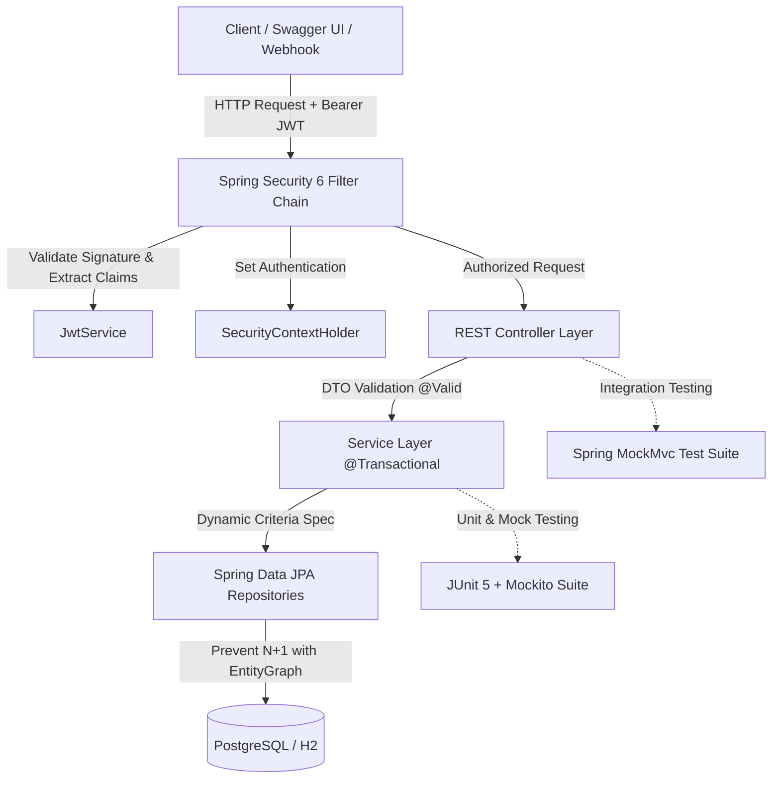

# AgileFlow — Enterprise Agile Task & Workflow Management REST API

[](https://adoptium.net/)
[](https://spring.io/projects/spring-boot)
[](https://spring.io/projects/spring-security)
[](https://www.postgresql.org/)
[](https://www.docker.com/)
[](https://github.com/)

A production-grade Agile Sprint & Task Management REST API built with modern **Java 21**, **Spring Boot 3**, and **Spring Security 6**. Designed to model enterprise Agile workflows (similar to Jira / Asana), featuring stateless JWT authentication, Role-Based Access Control (RBAC), dynamic multi-criteria JPA filtering, comprehensive automated test coverage, and Docker containerization.

---

## 🏛️ System Architecture



---

## ✨ Key Features

* **Modern Java 21 & Spring Boot 3**: Leverages immutable Java Records for DTOs, modern pattern matching, and Spring Boot 3.4 standards (`VIA_DTO` page serialization).
* **Stateless JWT Security & RBAC**:
  * Passwords hashed using industry-standard **BCrypt**.
  * Custom `OncePerRequestFilter` parsing HMAC-SHA256 signed JWT tokens.
  * 3 distinct roles: `ROLE_ADMIN` (Product Owner/Lead), `ROLE_MANAGER` (Scrum Master), and `ROLE_DEVELOPER` (Team Member).
* **Agile Sprint Workflow Engine**:
  * Full task lifecycle management: `BACKLOG` $\rightarrow$ `TODO` $\rightarrow$ `IN_PROGRESS` $\rightarrow$ `IN_REVIEW` $\rightarrow$ `DONE`.
  * Task priority classification: `LOW`, `MEDIUM`, `HIGH`, `CRITICAL`.
  * State transitions enforce ownership rules (assignees, creators, and leads have granular permissions).
* **High-Performance Querying & Search**:
  * Dynamic multi-field filtering (status, priority, assignee, text search) via JPA Criteria API `Specification<Task>`.
  * Paginated responses with sorting (`Pageable`).
  * Optimized fetch queries and `@EntityGraph` mappings to prevent Hibernate **N+1 query** performance bottlenecks.
* **Resilience & Production Standards**:
  * Standardized RFC 7807 error responses via `@RestControllerAdvice`.
  * Input validation using `jakarta.validation` (`@NotBlank`, `@Size`, `@FutureOrPresent`).
  * Interactive Swagger / OpenAPI 3 UI documentation with Bearer token authentication.
* **Testing Excellence (17 Automated Tests)**:
  * Unit tests with **JUnit 5** and **Mockito** covering business logic and authorization edge cases.
  * End-to-end controller integration tests using **MockMvc** with full Spring application context.

---

## 🚀 Quickstart

### Prerequisites
* **Java 21** or later
* Git
* (Optional) Docker & Docker Compose

### Option 1: Run Locally (Zero Config with In-Memory H2)

Clone the repository and run using the Maven wrapper:

```bash
# Clone repository
git clone https://github.com/yourusername/agile-task-api.git
cd agile-task-api

# Run application
./mvnw spring-boot:run
```
*(On Windows Command Prompt or PowerShell, use `.\mvnw.cmd spring-boot:run`)*

The application will start on **`http://localhost:8080`**.

### Option 2: Run with Docker Compose (App + PostgreSQL)

```bash
docker-compose up --build
```
This spins up:
* **API Service** on port `8080`
* **PostgreSQL 16** on port `5432` with healthcheck synchronization

---

## 📖 Interactive API Documentation (Swagger UI)

Once running, navigate to:
👉 **[http://localhost:8080/swagger-ui.html](http://localhost:8080/swagger-ui.html)**

### Pre-Seeded Demo Accounts

The application automatically seeds initial team members and sprint tasks on startup:

| Username | Password | Role | Description |
| :--- | :--- | :--- | :--- |
| `admin` | `password123` | `ROLE_ADMIN` | Full administrative privileges |
| `manager_anna` | `password123` | `ROLE_MANAGER` | Scrum Master / Project Lead |
| `dev_alex` | `password123` | `ROLE_DEVELOPER` | Software Developer |
| `dev_sarah` | `password123` | `ROLE_DEVELOPER` | Software Developer |

> **How to authorize in Swagger:**
> 1. Call `POST /api/auth/login` with `{"usernameOrEmail": "admin", "password": "password123"}`.
> 2. Copy the `accessToken` from the JSON response.
> 3. Click the green **Authorize 🔓** button at the top of Swagger UI.
> 4. Paste the token and click **Authorize**. All secured endpoints are now unlocked!

---

## 🔌 REST API Endpoints

### 🔑 Authentication (`/api/auth`)
| Method | Endpoint | Description | Access |
| :--- | :--- | :--- | :--- |
| `POST` | `/api/auth/register` | Register a new user account | Public |
| `POST` | `/api/auth/login` | Authenticate credentials and obtain JWT token | Public |

### 📋 Tasks (`/api/tasks`)
| Method | Endpoint | Description | Access |
| :--- | :--- | :--- | :--- |
| `POST` | `/api/tasks` | Create a new task (authenticated user becomes creator) | Authenticated |
| `GET` | `/api/tasks` | List/search tasks with pagination, sorting & filters | Authenticated |
| `GET` | `/api/tasks/{id}` | Get task details by ID | Authenticated |
| `PUT` | `/api/tasks/{id}` | Update task title, description, priority, assignee | Creator / Lead / Admin |
| `PATCH`| `/api/tasks/{id}/status` | Move ticket across Agile board columns | Assignee / Lead / Admin |
| `DELETE`| `/api/tasks/{id}` | Delete a task | Creator / Lead / Admin |

### 👥 Users (`/api/users`)
| Method | Endpoint | Description | Access |
| :--- | :--- | :--- | :--- |
| `GET` | `/api/users/me` | Get profile of currently logged-in user | Authenticated |
| `GET` | `/api/users` | List all team members (for task assignment) | Authenticated |
| `GET` | `/api/users/{id}` | Get user details by ID | Authenticated |

---

## 🧪 Running Automated Tests

Run the complete test suite (Unit + Integration tests):

```bash
./mvnw clean test
```

Sample output:
```text
[INFO] Running com.agileflow.api.controller.AuthControllerIntegrationTest
[INFO] Tests run: 3, Failures: 0, Errors: 0, Skipped: 0
[INFO] Running com.agileflow.api.controller.TaskControllerIntegrationTest
[INFO] Tests run: 4, Failures: 0, Errors: 0, Skipped: 0
[INFO] Running com.agileflow.api.service.AuthServiceTest
[INFO] Tests run: 3, Failures: 0, Errors: 0, Skipped: 0
[INFO] Running com.agileflow.api.service.TaskServiceTest
[INFO] Tests run: 6, Failures: 0, Errors: 0, Skipped: 0
[INFO] Running com.agileflow.api.AgileTaskApiApplicationTests
[INFO] Tests run: 1, Failures: 0, Errors: 0, Skipped: 0
[INFO] Results: Tests run: 17, Failures: 0, Errors: 0, Skipped: 0
[INFO] BUILD SUCCESS
```

---

## 💡 Engineering Decisions & Interview Talking Points

If asked about this project in an interview:

1. **Why Java Records for DTOs?**
   * Java Records provide compact, immutable data carriers with built-in implementations of `equals()`, `hashCode()`, and `toString()`. This guarantees thread-safety and prevents accidental mutations across architectural layers.
2. **How is the N+1 Query Problem Prevented?**
   * In `TaskRepository`, queries utilize JPA `@EntityGraph(attributePaths = {"creator", "assignee"})` and `LEFT JOIN FETCH` constructs to eagerly load associated user profiles in a single optimized SQL join, avoiding separate queries per row.
3. **Why Stateless JWT instead of Server-Side Sessions?**
   * In modern cloud-native / microservice architectures, stateless authentication allows multiple instances of the service behind a load balancer without requiring sticky sessions or distributed session synchronization.
4. **How are Permissions Handled?**
   * Endpoints combine high-level URL matching in `SecurityConfig` with fine-grained business logic checks in the service layer, verifying whether the caller is the task creator, assigned engineer, or a team lead before permitting modifications.

---

## 📄 License
This project is licensed under the Apache 2.0 License.
